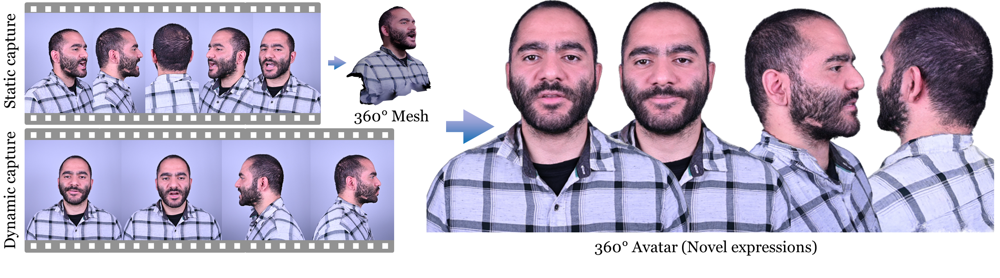

<div align="center">

# 360° Volumetric Portrait Avatar

**GCPR 2024 (Oral)**

[Jalees Nehvi](https://jalees018.github.io/)<sup>1</sup>, [Berna Kabadayi](https://ncs.is.mpg.de/person/bkabadayi)<sup>1</sup>, [Julien Valentin](https://scholar.google.co.uk/citations?user=pZPD0hMAAAAJ&hl=en)<sup>3</sup>, [Justus Thies](https://justusthies.github.io/)<sup>1,2</sup>

<sup>1</sup>Max Planck Institute for Intelligent Systems, Tübingen &nbsp;&nbsp; <sup>2</sup>Technical University of Darmstadt &nbsp;&nbsp; <sup>3</sup>Microsoft

[Project Page](https://jalees018.github.io/3VP-Avatar/) | [Paper](https://arxiv.org/pdf/2312.05311) | [arXiv](https://arxiv.org/abs/2312.05311) | [Video](https://www.youtube.com/watch?v=hSPnf6Kuyvo)



</div>

Given a monocular video of a person rotating in front of a single camera, 3VP Avatar reconstructs a photo-realistic 360°
portrait avatar. Facial tracking based on 3D morphable models hardly captures side views and fails for back views, so previous
avatars only cover the frontal hemisphere. We instead track the torso, head and facial expressions with a textured template of
the person, and use the tracking to train a neural radiance field that covers the person from all sides. A
deformation-field-based blend basis interpolates between appearance states, especially in the mouth region (lips and teeth).

This repository contains the official implementation.

## Method overview

1. **Template.** The static 360° turn is reconstructed as a textured canonical mesh, to which SMPL-X is registered.
2. **Template-based tracking.** The template is fitted to every frame of the video by differentiable rendering, see
   [Template-based tracking](#template-based-tracking).
3. **Avatar (stage 1).** Sample points are warped from the tracked mesh to the canonical space of a hash-grid NeRF. A blend
   basis of deformation fields, weighted by learned latents, models appearance changes.
4. **Mapping network (stage 2).** Predicts the blend weights from expression coefficients and jaw pose, to animate the avatar.

```
static 360° turn ──► textured canonical mesh ──► SMPL-X registration
                                                        │
video frames + DECA ────────────────────► template-based tracking
                                                        │
expression, jaw ──► mapping network ──► blend basis ──► canonical NeRF ──► 360° render
```

## Repository layout

| Path | Content |
|---|---|
| `run_pipeline.sh` | End-to-end pipeline for one subject. |
| `preprocessing/` | Keypoints, canonical mesh normalisation, landmarks, SMPL-X registration, DECA. |
| `tracking/` | Template-based tracking of torso, head and expressions (nvdiffrast). |
| `postprocessing/` | Error maps, smoothing of the tracked meshes, depth maps. |
| `nerf/` | Conditional NeRF, renderer, data loader, trainer, options. |
| `train.py`, `render.py` | Training (stages 1 and 2) and rendering. |
| `gridencoder/`, `raymarching/`, `shencoder/` | CUDA extensions from torch-ngp. |
| `smplx_deformer.py` | SMPL-X with per-vertex offsets and skinning transforms, on top of `smplx`. |
| `paths.py` | All data locations. |
| `assets/` | Masks and topology on the SMPL-X mesh (no SMPL-X geometry). |

## Installation

Tested with Python 3.8, PyTorch 2.0.1, CUDA 11.8, gcc 11 on Ubuntu 22.04 (RTX 4090, 24 GB). The paper results were
produced with PyTorch 1.6 / CUDA 10.1; the released code reproduces the paper renders from the original checkpoints in
the environment below.

**1. Main environment** (tracking, SMPL-X fitting, training, rendering)

```bash
git clone https://github.com/jalees018/3VP-Avatar.git && cd 3VP-Avatar
conda env create -f environment.yml          # Python, CUDA 11.8 compiler, PyTorch, requirements.txt
conda activate 3vp
```

**2. Compiled packages** (need PyTorch at build time, hence a separate step)

```bash
export CUDA_HOME=$CONDA_PREFIX FORCE_CUDA=1
export TORCH_CUDA_ARCH_LIST="8.9"            # your GPU: 8.9 = RTX 40xx, 8.6 = RTX 30xx, 7.5 = RTX 20xx
pip install --no-build-isolation "git+https://github.com/facebookresearch/pytorch3d.git@v0.7.4"
pip install --no-build-isolation "git+https://github.com/NVlabs/nvdiffrast.git@v0.3.1"

# bvh-distance-queries: set the host compiler (gcc <= 11 for CUDA 11.8) and
# return an error status instead of 0 when CUDA fails
git clone https://github.com/YuliangXiu/bvh-distance-queries.git external/bvh-distance-queries
sed -i "s#/usr/bin/gcc-7#$(which gcc)#" external/bvh-distance-queries/setup.py
sed -i "s/exit(0);/exit(1);/" external/bvh-distance-queries/src/bvh_cuda_op.cu
CUDA_SAMPLES_INC=$PWD/external/bvh-distance-queries/cuda-samples/Common \
    pip install --no-build-isolation ./external/bvh-distance-queries
```

The CUDA extensions in `gridencoder/`, `raymarching/` and `shencoder/` (from
[torch-ngp](https://github.com/ashawkey/torch-ngp)) are compiled automatically at first use. Set `CUDA_HOME=$CONDA_PREFIX`
whenever you run the code, and `PYOPENGL_PLATFORM=egl` on machines without a display.

**3. DECA environment** (only for processing a new sequence: facial landmarks and DECA, steps 1 and 7)

```bash
conda create -n 3vp-deca --clone 3vp && conda activate 3vp-deca
pip install -r requirements-deca.txt         # chumpy needs numpy < 1.24, hence the second environment
git clone https://github.com/YadiraF/DECA external/DECA      # or set VP_DECA_DIR
```

## Models and assets

| File | Needed for | Source |
|---|---|---|
| `models/smplx/SMPLX_NEUTRAL.npz` (v1.1) | SMPL-X fitting, tracking | https://smpl-x.is.tue.mpg.de (registration) |
| `assets/backbone.pth` (ArcFace `r18`) | training (perceptual loss) | [InsightFace `arcface_torch` model zoo](https://github.com/deepinsight/insightface/tree/master/recognition/arcface_torch#model-zoo) |
| `external/DECA/data/deca_model.tar` | DECA | [DECA README](https://github.com/yfeng95/DECA) |
| `external/DECA/data/generic_model.pkl` (FLAME 2020) | DECA | https://flame.is.tue.mpg.de (registration) |

Included in `assets/`: `smplx_masks.npz` (per-vertex masks on the SMPL-X topology, no SMPL-X geometry),
`canonical_template.npy` (19022-face topology) and `Adjacency_SMPL-X_Edges_3333.npy` (face adjacency).

The unmodified `smplx` package is sufficient: `smplx_deformer.py` adds the per-vertex offsets and skinning transforms
needed by fitting and tracking. As in the paper code, pose-corrective blend shapes are not applied.

## Downloads: dataset and checkpoints

The subjects are called `subject1` to `subject4`; use these names as `<subject>` in all commands.

| Subject | Dataset (frames, mattes, cameras, canonical mesh) | Tracking, DECA, depth and error maps | Checkpoints (stage 1 and mapping network) |
|---|---|---|---|
| `subject1` | **TODO: link** | **TODO: link** | **TODO: link** |
| `subject2` | **TODO: link** | **TODO: link** | **TODO: link** |
| `subject3` | **TODO: link** | **TODO: link** | **TODO: link** |
| `subject4` | **TODO: link** | **TODO: link** | **TODO: link** |

The dataset shows identifiable people; use it for non-commercial research only and follow the license terms that come with it.
Unpack the files so that they match the layout below.

## Data layout

All locations are configured in [`paths.py`](paths.py) and can be overridden with environment variables (`VP_WORK_DIR`,
`VP_IMAGES_DIR`, `VP_DATA_DIR`, `VP_TRACKER_DIR`, `VP_DECA_DIR`, `VP_SMPLX_DIR`, `VP_ASSETS_DIR`).
Defaults, relative to the repository (`<exp>` is the tracking experiment name, default `Results_`):

```
Images/<subject>/Images/<frame>.png             all frames of the sequence (consecutive, 4-digit numbers)
Images/<subject>/Images/_results/<frame>.png    portrait-matted RGBA frames
Images/<subject>/Keypoints/abc1_keypoints.json  OpenPose keypoints of one view (see below)
Images/<subject>/Images/{error_maps,Depth_Maps}/    written by steps 10 and 12

data/<subject>/images/*.png                     frames of the static 360° turn (~150 views)
data/<subject>/transforms_{train,val,test}.json cameras (instant-ngp format, incl. camera_angle_y) + "Trans", "Scalee"
data/<subject>/trajectory.json                  the same cameras: list of {"id", "focal_length", "transform_matrix"}

<workspace>/meshes/<subject>_111.obj + .jpg     textured canonical mesh (Metashape)
<workspace>/reg_results/                        SMPL-X registration (step 6)
<workspace>/checkpoints/                        ngp_ep*_cond.pth (stage 1), ngp_ep_Mapping_*_cond_Mapping.pth (stage 2)
<subject>.json                                  sequence segments (see below), next to the workspace

Tracker/<exp><subject>/                         tracking results (step 8) and smoothed meshes (step 11)
external/DECA/TestSamples/examples/results_<subject>/   DECA results (step 7)
```

### Capturing a new subject

A subject is filmed with one static camera while turning 360° in front of it.

* **Static 360° turn** (~150 frames): reconstruct it with [Agisoft Metashape](https://www.agisoft.com/) to get the camera of
  every view and a textured canonical mesh. The script that converted the Metashape export is not included; any
  photogrammetry tool works if the files follow these conventions:
  * `transforms_train.json`: frame list (`file_path`) and intrinsics (`fl_x`, `fl_y`, `cx`, `cy`, `w`, `h`,
    `camera_angle_x`, `camera_angle_y`). `Trans` (3-vector) and `Scalee` (scalar) map the mesh into the camera frame:
    `v' = (v - [Trans[1], Trans[2], Trans[0]]) * Scalee`.
  * `trajectory.json`: one camera-to-world pose per frame of `transforms_train.json`, **sorted by frame number**. Training uses these poses.
* **Full sequence** (~10k frames): all frames are rendered from the camera of the **last** frame of the turn, so the
  sequence must continue from that position. The tracker skips the last 100 frames of the folder.
* **Matting**: RGBA portrait mattes in `_results/`; we used
  [U^2-Net portrait matting](https://github.com/axinc-ai/ailia-models/tree/master/background_removal/u2net-portrait-matting).
* **OpenPose keypoints** (`abc1_keypoints.json`) for the **first** frame of `transforms_train.json`, in pixels of the 512×512
  image: `people[0]` with `face_keypoints_2d` of shape (1, 70, 2) and `pose_keypoints_3d` of shape (1, 25, 3), whose first
  two entries are the BODY_25 pixel coordinates. Note that raw OpenPose output stores flat `(x, y, confidence)` lists instead.
* **`<subject>.json`**: frame ranges relative to the first frame of the sequence: 11 expression segments `[start, end]`
  followed by one integer, the first free-form frame:
  `[[s0, e0], [s1, e1], ..., [s10, e10], first_freeform_frame]`.

## Testing with the released checkpoints

Run from the directory that contains the workspace (`VP_WORK_DIR`; by default the repository root). Needed: the
workspace (`checkpoints/`, `reg_results/`), `<subject>.json`, the dataset, the tracking results and the DECA results.

```bash
export CUDA_HOME=$CONDA_PREFIX PYOPENGL_PLATFORM=egl
ARGS="--workspace <workspace> --subject <subject> --scale 1.0 --bound 1.20 --dt_gamma 0.0 --bg_radius 2.0 \
      --num_steps 700 --lr 0.0025 --train_imgs <N> --expr <exp>"

# full model on held-out frames (expressions from DECA -> mapping network), starting at frame N
python render.py data/<subject> $ARGS --trainMapping --modes Train_MM

# stage-1 model with its learned per-frame latents, starting at the first free-form frame
python render.py data/<subject> $ARGS --modes single --view results_stage1
```

Output: `<workspace>/<view>/ngp_ep*_<frame>.png` (render) and `*_heat.png` (error map); `--view` defaults to `results`.
Both commands load the tracked meshes of the next 900 frames (`result_final_Real_tt_<i>_s.obj`). Useful options:
`--expression_source tracker` (tracked instead of DECA expressions), `--notrainposes` (novel camera path).
Rendering takes about 13 s per 512×512 frame on an RTX 4090.

## Full pipeline

```bash
DECA_PYTHON=$(conda info --base)/envs/3vp-deca/bin/python bash run_pipeline.sh <subject> <num_train_images> [workspace]
```

| Step | Script | Result |
|---|---|---|
| 1 | `preprocessing/detect_keypoints.py` (DECA env) | facial landmarks of all frames |
| 2–3 | `preprocessing/process.py`, `landmarks.py` | normalised canonical mesh and its 3D landmarks |
| 4–5 | `preprocessing/fit_smplx.py --stage normalise`, `landmarks.py` | metric scale |
| 6 | `preprocessing/fit_smplx.py --stage register` | SMPL-X registration |
| 7 | `preprocessing/run_deca.py` (DECA env) | per-frame expression and jaw pose |
| **8** | **`tracking/tracker.py`** | **template-based tracking** |
| 9–12 | `process.py`, `postprocessing/*` | sampling probabilities, error maps, smoothed meshes, depth maps |
| 13–14 | `train.py` | stage 1, stage 2 |
| 15 | `render.py` | held-out frames |

Skip steps with `SKIP="1 2 3"`. Step 4 re-centres and re-scales the mesh and the cameras in place; the originals are kept
(`*_unnormalised.obj`, `*.json.orig`) and always used as its input, so it can be re-run safely.

## Template-based tracking

Avatar methods usually rely on 3DMM face tracking, which fails for side and back views because facial landmarks and
parsing masks are missing there. One contribution of the paper is therefore to track the **torso, head and facial expression with a
textured template of the person itself**, which constrains the pose from all sides.

**How it works** (`tracking/tracker.py`)

1. **Template.** The textured canonical mesh from the static 360° turn. SMPL-X is registered to it once (step 6), and every template
   vertex is attached to its closest SMPL-X face (`tracking/nn_meshes.py`), from which it inherits skinning transforms and
   shape/expression offsets.
2. **Per-frame optimisation.** For each frame, starting from the previous result, Adam optimises the global rotation and translation,
   the neck and head pose, the jaw pose and 50 expression coefficients. The template is deformed, rendered with nvdiffrast and compared to the matted frame.
3. **Energy terms.** An L1 photometric term on the foreground; 2D landmarks (after the first 200 iterations, not on
   the first frame); regularisation of the jaw and expression towards temporally smoothed DECA estimates; pose regularisation; and
   temporal smoothness of the deformed vertices (after iteration 250).

**Inputs:** `<workspace>/meshes/<subject>.{obj,off}` and `<subject>_111.jpg` (steps 2–5), `<workspace>/reg_results/` (step 6),
`<workspace>/Landmarks_vertices.npy` (step 5), `Keypoints/keypoints.pkl` (step 1), the DECA results (step 7), matted frames
and the cameras. The landmarks and DECA results must cover all frames, not only those being tracked.

**Run**

```bash
conda activate 3vp
export CUDA_HOME=$CONDA_PREFIX PYOPENGL_PLATFORM=egl
python tracking/tracker.py --subject <subject> --exp Results_ --outdir . \
    --canonical_mesh_path <workspace>/meshes/ --smplx_meshes_path <workspace>/ \
    --input_images_path Images/ --base_file data/<subject> --width 512 --height 512
```

Folder arguments need a trailing `/`. The defaults (`--max-iter 400`) are the settings of the released tracker. It takes about
6 s per frame on an RTX 4090, so a 10k-frame sequence takes most of a day.

**Outputs** in `Tracker/<exp><subject>/`, for every frame `i`:

| File | Content |
|---|---|
| `result_final_Real_tt_<i>.pkl` | `pose`, `global_orient`, `jaw_pose`, `transl`, `expressions` |
| `result_final_Real_tt_<i>.obj` | tracked SMPL-X mesh |
| `Results_Deformed_tt_<i>.obj` | deformed template |
| `result_final_Real_tt_<i>_s.obj` | temporally smoothed SMPL-X mesh (step 11; used by training and rendering) |

Visualisations (input, SMPL-X, template, error) are written to `Tracker/pose/Images/<subject>_tracking/`. Check the first ones:
the template should overlap the person.

After tracking, run steps 9–12 before training:

```bash
SKIP="1 2 3 4 5 6 7 8 13 14 15" bash run_pipeline.sh <subject> <num_train_images> <workspace>
```

## Training

```bash
python train.py data/<subject> $ARGS                                  # stage 1: NeRF + deformation blend basis
python train.py data/<subject> $ARGS --trainMapping --modes Train_MM  # stage 2: mapping network
```

with `ARGS` as in [Testing](#testing-with-the-released-checkpoints). Required: the outputs of steps 1–12 and `assets/backbone.pth`.

* **Stages.** Stage 1 runs for 840k iterations (about 84 epochs for 10k frames; about a day). Epochs 1–39 use a pixel loss, later epochs a
  perceptual loss with frozen latents. Stage 2 fits the mapping network from expression and jaw pose to the latents (minutes).
* **`--train_imgs`** must cover the whole sequence including free-form frames: stage 2 only samples the neutral frame of each segment and
  frames from `first_freeform_frame` on.
* **GPU:** 24 GB. `--gpu_mem_fraction` (default 0.8) limits PyTorch's share, because the BVH library allocates its memory separately.
* **RAM:** all frames, error maps and depth maps are loaded into memory. Measured: about 9 GB for 900 frames; a 10k-frame sequence is
  estimated to need **more than 64 GB**. 32 GB is not enough.
* **Checkpoints** are saved every epoch (last two are kept). Stage 1 resumes from the latest checkpoint when started again;
  `stage1.done` / `stage2.done` in the workspace mark completed stages.
* `--cuda_ray` is not supported by the conditional renderer.

## Re-enactment

Add `--drive --driver <other_subject> --driver_incrementor <first_frame> --driver_neutral <neutral_frame>
--my_neutral <neutral_frame>` to the full-model `render.py` command, with the retargeted meshes in `Tracker/Meshes/<driving_folder>/With_Mean/`
(`--driving_folder`). The retargeting script that creates these meshes is not included.

## License

This code is released under a [software copyright license for non-commercial scientific research purposes](LICENSE).
Any commercial use is prohibited; for commercial licensing, contact jalees.nehvi@tu-darmstadt.de.
Third-party components keep their own licenses, listed below.

## Acknowledgements and licenses

This code builds on:

* The NeRF backbone and the CUDA extensions build on [torch-ngp](https://github.com/ashawkey/torch-ngp) (MIT).
* `tracking/tracker.py` and `tracking/util.py` are derived from the samples of
  [nvdiffrast](https://github.com/NVlabs/nvdiffrast) and are subject to the Nvidia Source Code License
  ([`LICENSES/nvdiffrast.txt`](LICENSES/nvdiffrast.txt)): they may be used **non-commercially only** (research or
  evaluation). `preprocessing/landmarks.py` and `preprocessing/process.py` also keep NVIDIA's copyright header.
* [SMPL-X](https://smpl-x.is.tue.mpg.de), [DECA](https://github.com/yfeng95/DECA) / FLAME,
  [bvh-distance-queries](https://github.com/YuliangXiu/bvh-distance-queries),
  [InsightFace](https://github.com/deepinsight/insightface) (ArcFace weights: non-commercial research only),
  [face-alignment](https://github.com/1adrianb/face-alignment) and [PyTorch3D](https://github.com/facebookresearch/pytorch3d).

Please also cite these works and respect their licenses when using this code.

## Citation

If you find this work useful, please cite:

```bibtex
@inproceedings{10.1007/978-3-031-85187-2_1,
author = {Nehvi, Jalees and Kabadayi, Berna and Valentin, Julien and Thies, Justus},
title = { Volumetric Portrait Avatar},
year = {2025},
isbn = {978-3-031-85186-5},
publisher = {Springer-Verlag},
address = {Berlin, Heidelberg},
url = {https://doi.org/10.1007/978-3-031-85187-2_1},
doi = {10.1007/978-3-031-85187-2_1},
abstract = {We propose  Volumetric Portrait (3VP) Avatar, a novel method for reconstructing  photo-realistic portrait avatars of human subjects solely based on monocular video inputs. State-of-the-art monocular avatar reconstruction methods rely on stable facial performance capturing. However, the common usage of 3D Morphable Model (3DMM)-based facial tracking has its limits; side-views can hardly be captured and it fails, especially, for back-views, as required inputs like facial landmarks or human parsing masks are missing. This results in incomplete avatar reconstructions that only cover the frontal hemisphere. In contrast to this, we propose a template-based tracking of the torso, head and facial expressions which allows us to cover the appearance of a human subject from all sides. Thus, given a sequence of a subject that is rotating in front of a single camera, we train a neural volumetric representation based on neural radiance fields. A key challenge to construct this representation is the modeling of appearance changes, especially, in the mouth region (i.e., lips and teeth). We, therefore, propose a deformation-field-based blend basis which allows us to interpolate between different appearance states. We evaluate our approach on captured real-world data and compare against state-of-the-art monocular reconstruction methods. In contrast to those, our method is the first monocular technique that reconstructs an entire  avatar. Project page: .},
booktitle = {Pattern Recognition: 46th DAGM German Conference, DAGM GCPR 2024, Munich, Germany, September 10–13, 2024, Proceedings, Part II},
pages = {3–19},
numpages = {17},
keywords = {Volumetric Portrait Avatars, 360-degree, Monocular},
location = {Munich, Germany}
}
```
